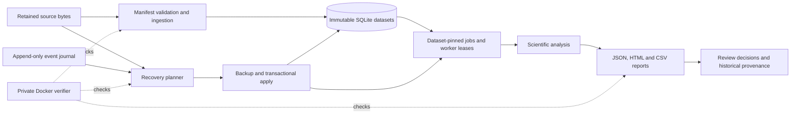

# Recover screening evidence across interrupted migrations

A Python/SQLite research application and a runnable coding-agent evaluation task covering corrected evidence, queued analyses, historical reports and recovery from incomplete migrations. The application has **29 Python modules**; the complete verifier contains **185 executable checks**. All included measurements and incident histories are synthetic.

This repository demonstrates task authoring, reproducible containerized environments, test and verifier design, code review, and evidence-based analysis of coding-agent attempts. The task exercises changes across persistence, ingestion, scheduling and reporting rather than a standalone algorithm.

## Engineering problem

Corrected instrument deliveries can contain different scientific evidence despite identical numerical measurements. Fixing future imports leaves suppressed historical deliveries unrepaired. A migration must reconstruct retained source bytes, reconcile queued jobs to their submission context, adopt verifiable partial recovery, and preserve completed results and reviews.

Allocated revision numbers and the currently published evidence can diverge during recovery. Legacy transfer formats, incomplete provenance, immutable history, backup safety and repeat runs make the repair cross multiple modules.

## Architecture



## Docker and testing

| Capability | Inspectable implementation |
|---|---|
| Reproducible environments | Base image pinned by digest; Python dependencies pinned with hashes in both Docker builds |
| Application isolation | Application image runs as a non-root user; no network is needed for execution |
| Verifier isolation | Candidate commands run under separate unprivileged UIDs; read-only candidate mount, network disabled, resource limits and protected receipt volume |
| Behavioral verification | Source fingerprints, full normalized inputs, publication/submission history, immutable records, report rows and real command execution |
| Migration safety | Consistent SQLite backup, writer serialization, whole-apply rollback, staged-work preservation and repeat safety |
| Calibration and review | Three independent solver sessions, frozen final source, intermediate source states and documented verifier corrections |

The trusted verifier supervisor starts as root to isolate candidate subprocesses and protect receipts. Candidate code executes under a separate unprivileged UID. The solver does not receive the reference, private fixtures or grading code.

## Reproduce locally

Docker with a working daemon and Python 3 are required. Recorded executions used Linux ARM64. Other architectures must rebuild and run the checks; their results are not assumed equivalent.

```sh
# Build the verifier and record its local image identity.
python3 tools/build_verifier.py

# Run all 43 application tests inside the container as an unprivileged user.
python3 tools/test_application.py

# Export only the public task to a fresh workspace outside this repository.
python3 tools/prepare_attempt.py /absolute/path/to/new-attempt

# Evaluate the known-correct reference, or substitute a completed attempt.
python3 validation/evaluate.py reference --checks 11r4-full --output local-runs/reference
python3 validation/grade_attempt.py 11-transfer-history-reconstruction   local-runs/reference --inventory validation/runtime-inventory.local.json   --output local-runs/reference-grade.json
```

`11r4` selects only the eight new recovery-history checks. Use `11r4-full` for functional completion. The evaluator returns a nonzero exit code for failures; the grade distinguishes functional evidence from human maintainer acceptance.

Build the application image independently:

```sh
docker build -t truegate-screening:local application

docker run --rm --network none --read-only --cap-drop ALL   --tmpfs /tmp:rw,nosuid,nodev,size=64m,mode=1777   --mount "type=bind,src=$PWD/task/candidate/examples/recovery-incident/study.db,dst=/input.db,readonly"   --entrypoint /bin/sh truegate-screening:local   -c 'cp /input.db /tmp/study.db; python -m truegate.cli evidence-recover --db /tmp/study.db --dry-run'
```

Use a copy of the incident database. Applying recovery additionally requires a new backup destination. See [the recovery interface](application/docs/evidence-recovery.md) and [task preparation](tools/prepare_attempt.py).

## What the verifier checks

- Complete evidence identity and dataset-scoped job reuse.
- Per-well report completeness, including equal-dose observations.
- Retained-format decoding and complete normalized input content.
- Adoption of verified prior recovery without duplicate revisions.
- Publication-based current selection, queued-job pins and review/import compatibility.
- Original datasets, source bytes, events, completed runs, review decisions and worker state.
- Damaged or ambiguous evidence, key collisions, backup protection, rollback and idempotence.

Earlier scientific and workflow checks remain in the suite as application regressions. This package contains one task, not the other standalone task submissions from the local collection. Test counts are not percentage coverage or proof that every shortcut has been ruled out.

## Recorded results

| Execution | Full private checks | Recorded wall time |
|---|---:|---:|
| Author reference | 185/185 | See bound receipt |
| Fresh solver attempt 1 | 179/185 | 593.39 seconds |
| Fresh solver attempt 2 | 185/185 | 576.23 seconds |
| Fresh solver attempt 3 | 179/185 | 469.85 seconds |

The two incomplete attempts omit preserved-record inventories for unaffected and blocked studies. Their database records remain intact. Six failures share this one report-interface cause. All three handle the eight new focused recovery checks.

The intended three substantive repair cycles were **not demonstrated**. This task remains provisional for long-horizon use. The attempts ran concurrently on one host; these timings are not an isolated performance benchmark or a population solve-rate estimate.

The [calibration review](evidence/REVIEW.md) explains intermediate errors, final misses and verifier corrections. Unsupported inherited assertions and an incomplete scheduler fixture were corrected rather than counted as solver failures. Public task inputs stayed unchanged and no private feedback reached the solvers.

See [engineering and scientific decisions](ENGINEERING.md) for the assay context, module boundaries, container design and verifier trade-offs.

## Repository map

- `application/`: maintained application, Dockerfile, scientific documentation, examples and public tests.
- `task/candidate/`: faulty public checkout and concise operator issue.
- `task/`: task manifest, author rubric and actual reference patch.
- `reference/`: complete correct implementation used for validation.
- `validation/`: validated Docker verifier, private fixtures, executable checks and grading.
- `evidence/`: actual receipts, extracted commands and outputs, source states and untouched solver final payloads in verified archives, with reviewable source patches.
- `tools/`: public-workspace export, reproducible build, public testing and file verification.

This portfolio repository includes author reference answers and grading fixtures for reproducibility. Prepare a solver-only workspace before an isolated evaluation run; the candidate must not receive the reference or verifier materials.

## CI and troubleshooting

[GitHub Actions](https://github.com/hiddenlif/truegate-screening-evidence-recovery/actions/workflows/validate.yml) builds both images, runs application tests, evaluates the full reference and retains real test receipts on pushes and pull requests. Its run status is reported by GitHub; no static passing badge is used.

- **Docker unavailable:** start Docker and confirm `docker info` succeeds. Daemon/build errors are infrastructure failures, not task scores.
- **Different image identity:** run `tools/build_verifier.py`. It verifies packaged source hashes and records a local runtime inventory. Historical receipts keep their original image binding.
- **Existing output directory:** choose a fresh directory; evaluation receipts are never overwritten.
- **Different platform:** rebuild and inspect actual results. Dependency installation or platform failures require investigation before grading claims.

## Review boundaries

This is research software and synthetic task evidence. It is not a validated clinical, manufacturing or production deployment. Human maintainer acceptance remains separate from automated grading. The supplied evidence demonstrates specific executions and known limits, not universal verifier security or proven long-horizon difficulty.

See [the README outline](README-OUTLINE.md), [file review](UPLOAD-REVIEW.md), and [evidence portability notes](evidence/PORTABILITY.md).
