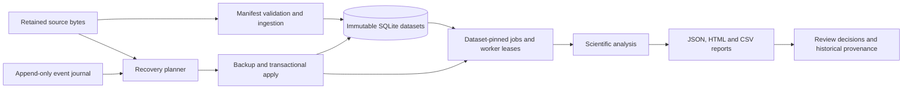

# AI Evaluation Task: Laboratory Data Recovery

Repair a Python/SQLite research application so that corrected evidence, queued analyses, historical reports and recovery from incomplete migrations all agree.

This is a self-contained programming task for scientific data analysis. The application, measurements and incident histories are synthetic; the studies, instruments and sites are invented.

## Engineering problem

Corrected instrument deliveries can contain different scientific evidence despite identical numerical measurements. Fixing future imports leaves suppressed historical deliveries unrepaired. A migration must reconstruct retained source bytes, reconcile queued jobs to their submission context, adopt verifiable partial recovery, and preserve completed results and reviews.

Allocated revision numbers and the currently published evidence can diverge during recovery. Legacy transfer formats, incomplete provenance, immutable history, backup safety and repeat runs make the repair cross multiple modules: persistence, ingestion, scheduling and reporting.



## What is here

- `TASK.md`: the task statement.
- `app/`: the faulty checkout the task starts from: source, public tests, documentation, examples and a Dockerfile. `app/ISSUE.md` is the operator report and `app/docs/evidence-recovery.md` describes the recovery interface.
- `app/examples/recovery-incident/study.db`: the supplied incident database. Work on a copy.

Not included: the reference solution and the verifier. Every repair is checked against independent evidence histories, so a passing public test run does not establish that the task is solved.

## Run

Python 3.12 or newer. From `app/`:

```sh
uv sync --frozen
uv run pytest
```

Or with Docker:

```sh
docker build -t lab-data-recovery app
docker run --rm --network none lab-data-recovery analyze /app/examples/screening.json
```

Use a copy of the incident database when trying the recovery command. Applying recovery needs a new backup destination.

## Reference solution and verifier

The reference solution and the verifier, which holds the private fixtures, the executable checks and the grading code, are not in this repository. They are kept in the private repository `science-task-solutions`, in the `LabDataRecovery/` folder, together with a script that runs the verifier on a candidate.

## Review boundaries

This is research software and synthetic task data. It is not a validated clinical, manufacturing or production system.
